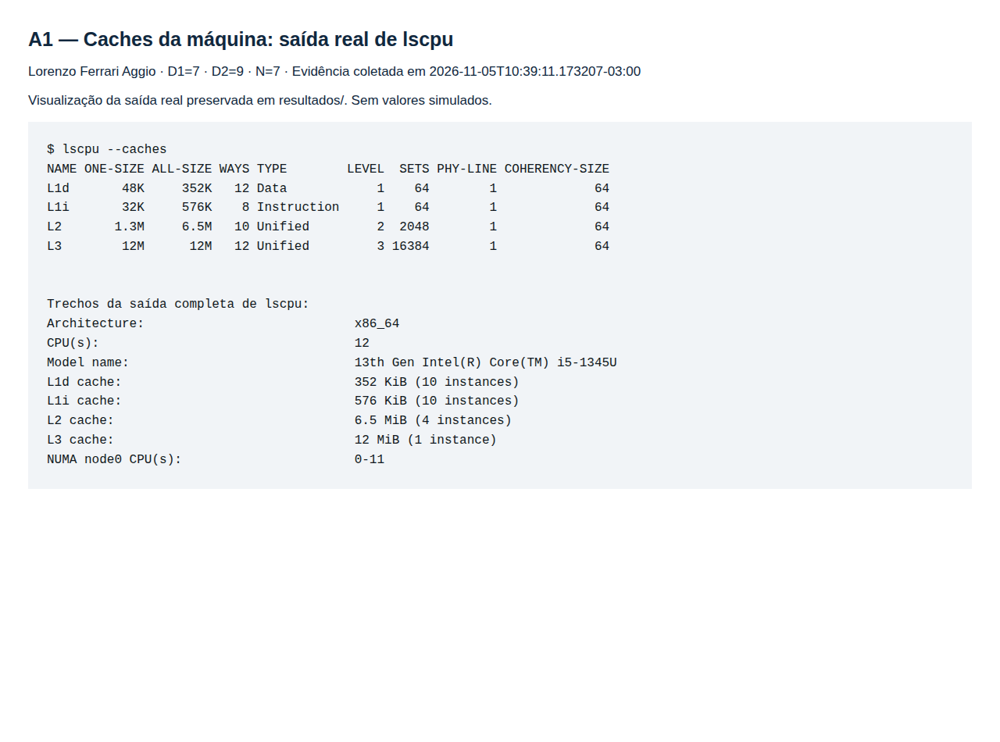
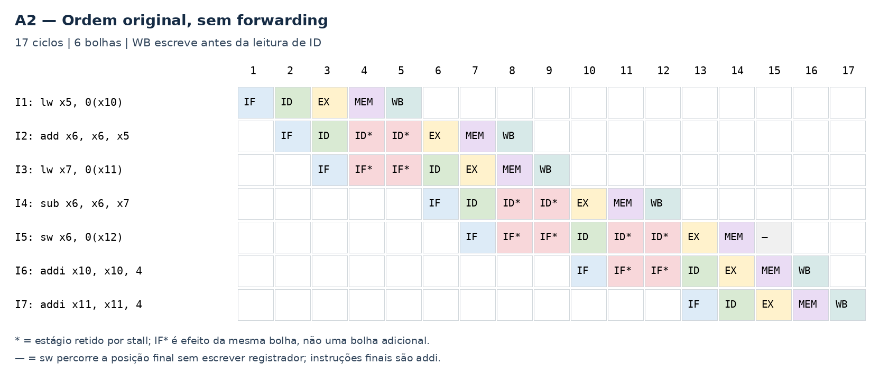
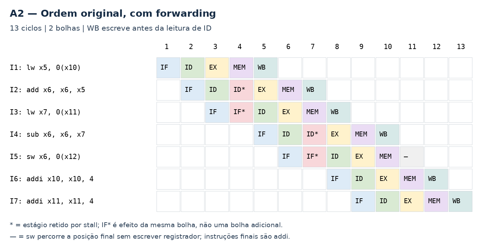
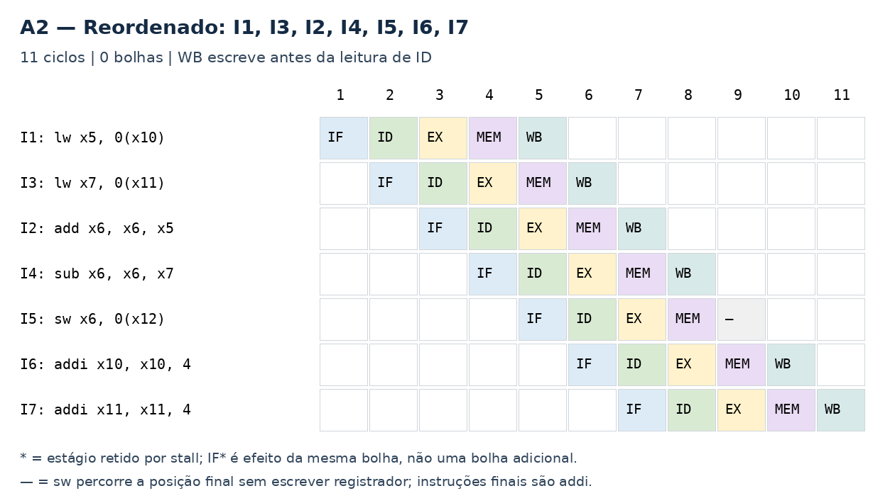
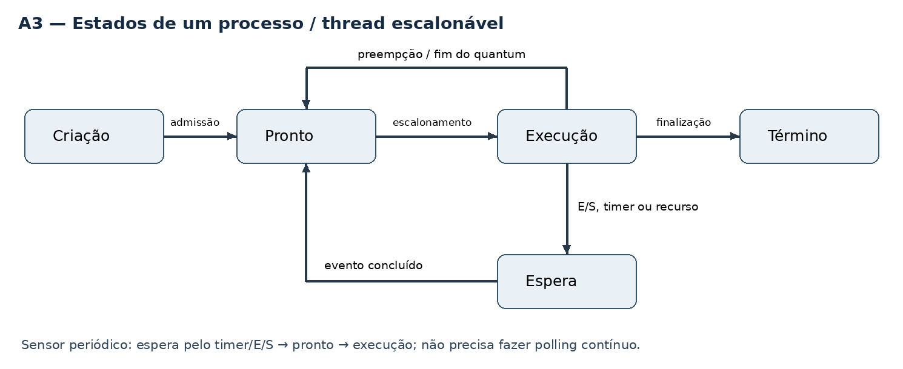
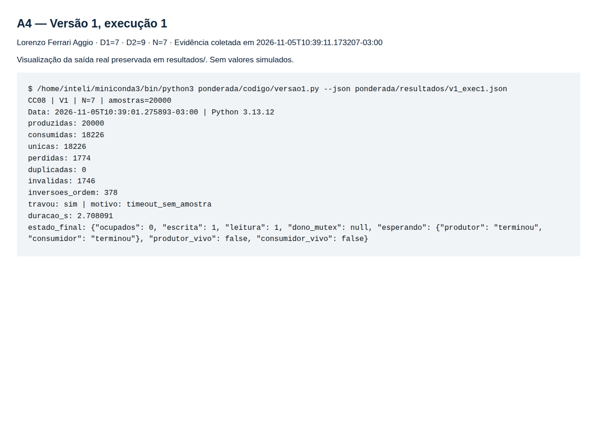
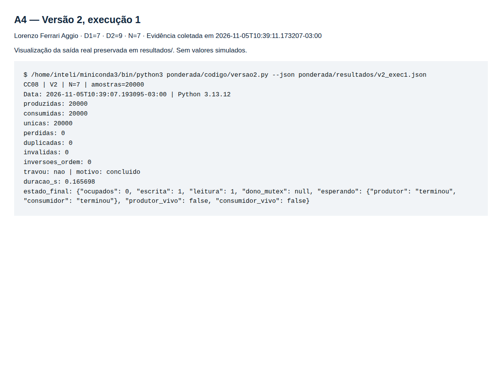
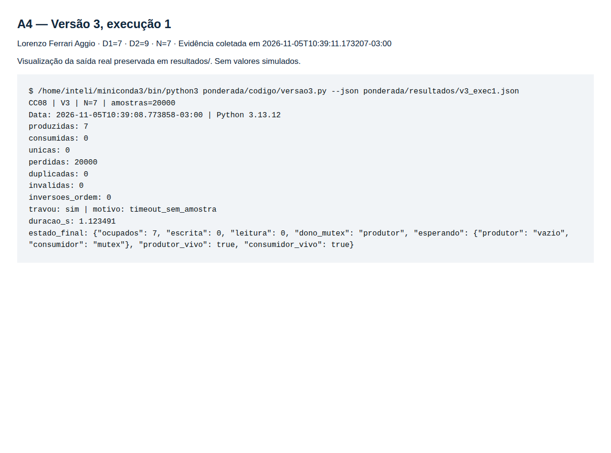
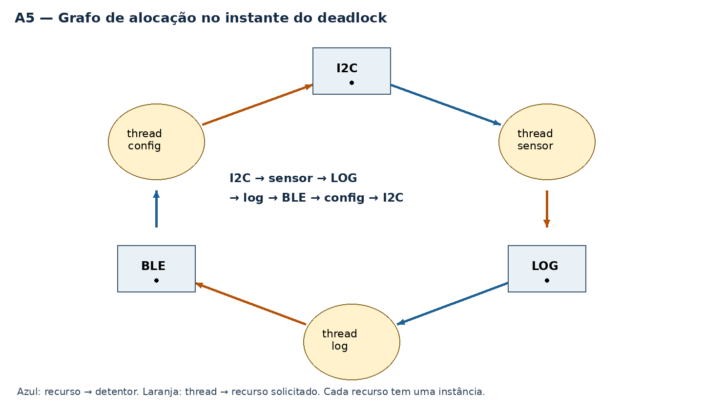

Lorenzo Ferrari Aggio — D1 = 7; D2 = 9; N = 7.

# Ponderada CC08 — do pipeline ao deadlock

## Parâmetros individuais e premissas

Lorenzo tem 7 letras; Ferrari, 7; Aggio, 5. Total: 7 + 7 + 5 = 19 letras.

- D1 = 7.
- D2 = último dígito de 19 = 9.
- IC = 100.000 + 20.000 × 9 = **280.000 instruções por amostra**.
- m = 3% + 0,5% × 7 = **6,5% = 0,065**.
- N = 3 + (9 mod 5) = 3 + 4 = **7 posições**.
- Amostragem: 100 Hz, período 10 ms. Prazo de processamento: **5 ms por amostra**.

Os cálculos analisam o modelo de processamento da pulseira, sem representar um benchmark físico.
As execuções da A4 são reais, feitas em Linux/Python 3.13.12 em 05/11/2026.
O experimento usa 20.000 amostras sem espaçamento de 10 ms para estressar o buffer;
não representa validação de tempo real do produto.

# Parte A — o problema técnico

## A1. Arquitetura e memória

### 1. Plataforma H sem DSP

Tempo de CPU = IC × CPI / frequência.

T_H = (280.000 × 1,5) / 48.000.000 = 420.000 / 48.000.000 s
= 0,00875 s = **8,75 ms**.

O processamento **excede 5 ms em 3,75 ms**. Terminar antes da próxima amostra,
que chega em 10 ms, não basta: o prazo especificado é 5 ms.

### 2. Plataforma V: AMAT, CPI efetivo e atraso do SO

Analisando o impacto das faltas de cache, considero 120 ciclos como **penalidade
adicional** de miss no CPI. O ciclo dura 1 / 1,2 GHz = 0,833333 ns.

AMAT = tempo de acerto + taxa de falta × penalidade
= 1 + 0,065 × 120 = **8,8 ciclos por acesso**
= 8,8 × 0,833333 ns = **7,333333 ns**.

Paradas médias por instrução = 1,3 × 0,065 × 120 = **10,14 ciclos**.

CPI_efetivo = 1,0 + 10,14 = **11,14 ciclos por instrução**.

T_V = (280.000 × 11,14) / 1.200.000.000
= 3.119.200 / 1.200.000.000 s = **2,599333 ms**.

Cenário com atraso máximo do sistema operacional = T_V + atraso máximo do SO
= 2,599333 + 3 = **5,599333 ms**.

**O processamento médio fica abaixo de 5 ms, mas o atraso máximo do SO muda o resultado:**
o tempo total ultrapassa o prazo em aproximadamente 0,599333 ms.

Há duas ressalvas de interpretação. Se "falta custa 120 ciclos" for entendido
como custo total, o AMAT seria (1 − 0,065) × 1 + 0,065 × 120 = **8,735 ciclos**;
o cálculo de CPI acima considera 120 ciclos adicionais por falta. Além disso,
somar jitter máximo a um tempo baseado em taxa média de misses não demonstra
WCET formal: a sequência de faltas também pode variar. O número 5,599333 ms é
o cenário com jitter máximo **sob essas premissas**, não uma garantia física de latência.

### 3. DSP na Plataforma H: Lei de Amdahl

Fração acelerada p = 0,60; aceleração dessa parte s = 5.

Speedup_global = 1 / [(1 − p) + p/s]
= 1 / [0,40 + 0,60/5] = 1 / 0,52 = **1,923077 vezes**.

Novo tempo = 8,75 × 0,52 = **4,55 ms**.

Conferência por partes: filtro = 8,75 × 0,60 = 5,25 ms;
com DSP, 5,25/5 = 1,05 ms. Restante = 8,75 × 0,40 = 3,50 ms.
Total = 1,05 + 3,50 = **4,55 ms**.

Com o DSP, a margem em relação ao limite é de 5 − 4,55 = **0,45 ms**, ou 9% do prazo.

| Plataforma | Tempo de processamento | Incluindo o atraso máximo de SO | Resultado frente ao limite de 5 ms |
|---|---:|---:|---|
| H | 8,75 ms | 8,75 ms | Acima do limite |
| V | 2,599333 ms, médio | 5,599333 ms | Acima do limite no cenário com jitter |
| H + DSP | 4,55 ms | 4,55 ms | Abaixo do limite; margem de 0,45 ms |

### 4. Cache e gargalo de memória nas duas plataformas

A V opera a 1,2 GHz, mas sua DRAM externa não acompanha esse ritmo; a cache reduz a espera.
No modelo Von Neumann, buscas de instruções e acessos a dados disputam o caminho de memória.
Esse descompasso de capacidade de transferência é parte do gargalo de Von Neumann.
A H usa SRAM interna de um ciclo a 48 MHz e caminhos Harvard separados, dispensando cache no modelo.

### 5. Evidência da máquina



Fontes brutas: [lscpu](resultados/lscpu.txt) e [lscpu --caches](resultados/lscpu-caches.txt).
Máquina: **Intel Core i5-1345U de 13ª geração, x86-64**, 12 CPUs lógicas.
`lscpu` informa L1d de 352 KiB e L1i de 576 KiB, valores agregados entre instâncias.
A captura mostra que **L1 é dividida entre instruções e dados**. Não interpreto
o tamanho agregado como se fosse o tamanho de uma única cache de um núcleo.

Isso caracteriza uma organização **Harvard modificada na hierarquia interna**.
O modelo de programação x86-64 continua tendo espaço de endereçamento unificado
para código e dados, associado a Von Neumann. Logo, separar a L1 não torna a
máquina inteira uma Harvard pura; os termos dependem do nível de abstração.

## A2. Pipeline do filtro

Numeração original:

```asm
I1: lw   x5, 0(x10)
I2: add  x6, x6, x5
I3: lw   x7, 0(x11)
I4: sub  x6, x6, x7
I5: sw   x6, 0(x12)
I6: addi x10, x10, 4
I7: addi x11, x11, 4
```

### 1. Dependências RAW

| Produtora | Consumidora | Registrador | Motivo |
|---|---|---|---|
| I1 | I2 | x5 | Soma precisa da amostra nova |
| I2 | I4 | x6 | Subtração precisa da soma atualizada |
| I3 | I4 | x7 | Subtração precisa da amostra antiga |
| I4 | I5 | x6 | Store precisa do resultado final |

I2 também é ancestral de I5 pela cadeia I2 → I4 → I5, mas o produtor direto
do x6 lido pelo store é I4. Os x10 e x11 originais são lidos antes de I6 e I7
os atualizarem; essas relações de nome/endereço não são novas RAW neste trecho.

### 2. Sem forwarding



O banco escreve na primeira metade do ciclo e é lido na segunda: ID pode ler
o resultado no mesmo ciclo em que a produtora está em WB.

| Instrução | IF inicial | ID, incluindo retenções | EX | MEM | WB |
|---|---:|---|---:|---:|---:|
| I1 | 1 | 2 | 3 | 4 | 5 |
| I2 | 2 | 3–5 | 6 | 7 | 8 |
| I3 | 3, retido até 5 | 6 | 7 | 8 | 9 |
| I4 | 6 | 7–9 | 10 | 11 | 12 |
| I5 | 7, retido até 9 | 10–12 | 13 | 14 | — |
| I6 | 10, retido até 12 | 13 | 14 | 15 | 16 |
| I7 | 13 | 14 | 15 | 16 | 17 |

I1 → I2 causa duas bolhas; I3 → I4, mais duas; I4 → I5, outras duas.
A dependência I2 → I4 já é satisfeita dentro da espera por I3.
Total = 7 instruções + 4 ciclos para preencher/esvaziar + 6 bolhas = **17 ciclos**.
O store usa os dados obtidos em ID e não escreve registrador em WB.

### 3. Com forwarding



Considero forwarding completo, incluindo o dado que o store leva à memória.

| Instrução | IF inicial | ID, incluindo retenções | EX | MEM | WB |
|---|---:|---|---:|---:|---:|
| I1 | 1 | 2 | 3 | 4 | 5 |
| I2 | 2 | 3–4 | 5 | 6 | 7 |
| I3 | 3, retido até 4 | 5 | 6 | 7 | 8 |
| I4 | 5 | 6–7 | 8 | 9 | 10 |
| I5 | 6, retido até 7 | 8 | 9 | 10 | — |
| I6 | 8 | 9 | 10 | 11 | 12 |
| I7 | 9 | 10 | 11 | 12 | 13 |

Permanecem **duas bolhas load-use**, uma em I1 → I2 e outra em I3 → I4.
O load disponibiliza o dado somente ao final de MEM; a instrução imediatamente
seguinte o precisaria em EX antes disso. Adiantar o dado não antecipa sua produção.
Total = 7 + 4 + 2 = **13 ciclos**.

### 4. Reordenação sem bolhas

```asm
lw   x5, 0(x10)       # I1
lw   x7, 0(x11)       # I3, antecipada
add  x6, x6, x5       # I2
sub  x6, x6, x7       # I4
sw   x6, 0(x12)       # I5
addi x10, x10, 4      # I6
addi x11, x11, 4      # I7
```



Agora existe uma instrução independente entre cada load e seu consumidor.
I3 não lê nem escreve os registradores que I2 modifica e não ultrapassa um store.
As operações em x6 preservam sua ordem e os ponteiros só mudam após os loads.
Isso preserva o resultado nas condições normais de execução do exercício.
Com encaminhamento ALU→ALU e ALU→dado do store, total = 7 + 4 = **11 ciclos**.

## A3. Processos e threads

### 1. Organização proposta na Plataforma V

| Unidade | Organização | Justificativa |
|---|---|---|
| Aquisição | Thread do processo de controle | Espera pelo timer/sensor e publica amostras |
| Filtro | Thread do mesmo processo | Compartilha amostras por buffer limitado, sem cópia entre processos |
| Vibração | Thread do mesmo processo | Consome resultados; não espera pela rede |
| BLE, logs remotos e comandos | Processo separado e com privilégio mínimo | Isola memória e falhas de uma entrada externa |

Threads de controle compartilham memória e recursos, com criação e troca de contexto
normalmente mais leves do que processos com espaços de endereçamento separados.
Essa economia exige sincronização: compartilhar memória não torna as atualizações atômicas.
Separar BLE acrescenta custo de IPC, serialização e escalonamento, compensado pelo isolamento.

Usaria um canal local de mensagens com tamanho e frequência limitados para logs/configuração.
O processo de controle valida comandos e publica uma configuração consistente;
o caminho sensor→filtro→motor não aguarda confirmações BLE. Logs podem ser descartados
sob sobrecarga, com contabilização, preservando o processamento prioritário.
Na H, essa organização teria de ser adaptada a firmware, pois a plataforma considerada não utiliza SO.

### 2. Exploração de falha no BLE

Como thread, o módulo compartilha o espaço de endereçamento e as credenciais do
processo principal: uma falha pode corromper buffers, configuração e controle do motor.
Como processo separado, o SO aplica uma fronteira de memória e permissões.
Uma falha não ganha automaticamente acesso direto à memória do controle.
O isolamento exige privilégios mínimos e validação do IPC; não elimina ataques
por comandos válidos em formato, mas perigosos, nem torna o sistema invulnerável.

### 3. Estados e comportamento do sensor



Criação → pronto → execução; execução → pronto por preempção; execução → espera
por E/S/timer/recurso; espera → pronto quando o evento ocorre; execução → término.
No modelo apresentado não há transição direta espera→execução.

A thread periódica do sensor passa a maior parte do tempo **bloqueada em espera**,
aguardando a próxima ativação de 10 ms ou a conclusão da E/S. A leitura deve ser curta,
e o trabalho de filtragem foi atribuído a outra thread. Fazer polling contínuo a
manteria pronta/em execução e desperdiçaria CPU. Essa conclusão depende dessa
implementação bloqueante, não de uma propriedade inevitável de todo sensor.

## A4. Buffer circular e semáforos

### Método e reprodução

Código: [V1](codigo/versao1.py), [V2](codigo/versao2.py), [V3](codigo/versao3.py)
e [motor comum](codigo/experimento.py). Cada versão roda com um comando do README.
O [executor](codigo/executar_experimentos.py) inicia um processo independente por rodada.
Não há atrasos de amostragem, para observar a concorrência em 20.000 IDs, de 0 a 19.999.

Watchdog: interrompe o experimento após **1 s sem uma amostra válida recebida**.
As threads experimentais são daemon para que um deadlock não impeça o registro
e o término do processo. O watchdog não libera semáforos artificialmente.
Ele contém o experimento; não é uma correção do algoritmo de sincronização.

Definições: consumidas = ocorrências válidas recebidas; únicas = IDs distintos;
duplicadas = ocorrências excedentes; perdidas = 20.000 − únicas.
Assim, na execução interrompida, "perdidas" inclui IDs ainda não produzidos;
não significa que todos foram fisicamente sobrescritos. Leituras de `None`
ou IDs inválidos são contabilizadas à parte. Os arrays efetivamente lidos estão
nos JSONs, permitindo recalcular as métricas.

### Nove execuções reais — N = 7

| Versão | Rodada | Produzidas | Consumidas | Perdidas | Duplicadas | Inválidas | Travou? | Duração (s) |
|---|---:|---:|---:|---:|---:|---:|---|---:|
| V1 | 1 | 20.000 | 18.226 | 1.774 | 0 | 1.746 | Sim | 2,708091 |
| V1 | 2 | 20.000 | 18.096 | 1.904 | 0 | 1.942 | Sim | 2,823429 |
| V1 | 3 | 20.000 | 18.328 | 1.672 | 0 | 1.617 | Sim | 2,771508 |
| V2 | 1 | 20.000 | 20.000 | 0 | 0 | 0 | Não | 0,165698 |
| V2 | 2 | 20.000 | 20.000 | 0 | 0 | 0 | Não | 0,153422 |
| V2 | 3 | 20.000 | 20.000 | 0 | 0 | 0 | Não | 0,189174 |
| V3 | 1 | 7 | 0 | 20.000 | 0 | 0 | Sim | 1,123491 |
| V3 | 2 | 7 | 0 | 20.000 | 0 | 0 | Sim | 1,111647 |
| V3 | 3 | 7 | 0 | 20.000 | 0 | 0 | Sim | 1,117334 |

Dados completos: [CSV](resultados/resumo.csv), [manifesto e hashes](resultados/manifesto.json)
e arquivos `resultados/v{versao}_exec{rodada}.json`, `.txt` e `.stderr.txt`.
As durações são do experimento completo, não a latência por amostra da A1.
Na V1 e na V3 incluem o período de detecção de falta de progresso.

### V1 — região crítica e condição de corrida



A região crítica compreende o acesso às posições compartilhadas e, sobretudo,
a leitura-modificação-escrita de `ocupados`, atualizada por produtor e consumidor.
Cada índice tem somente um escritor, mas sua relação com o estado do buffer é
invalidada quando o contador deixa de representar a ocupação real.

Exemplo: ambos leem ocupados=3; o produtor prepara 4 e o consumidor prepara 2.
Uma escrita pode apagar o efeito da outra; o estado correto após uma inserção
e uma retirada continuaria sendo 3. O `sleep(0)` entre leitura e escrita cria
oportunidade de intercalação. O GIL não torna essa sequência composta atômica.

Contagem incorreta permite sobrescrever amostras não consumidas ou ler uma posição
vazia. O programa limpa a posição após a retirada; as três rodadas mostraram
**perdas e leituras inválidas, sem duplicações válidas**. Não invento duplicações
para combinar com uma expectativa. Os números variam com o escalonamento.
"Travou" na V1 significa falta de recepção pelo timeout de 1 segundo, não
comprova um deadlock por espera circular.

### V2 — o que cada semáforo garante



| Semáforo | Inicial | Função |
|---|---:|---|
| vazio | 7 | Reserva uma posição antes de inserir; impede sobrescrita de buffer cheio |
| cheio | 0 | Reserva um item antes de retirar; impede leitura de buffer vazio |
| mutex | 1 | Serializa as alterações do buffer/contador, preservando sua consistência |

Produtor: P(vazio) → P(mutex) → inserir → V(mutex) → V(cheio).
Consumidor: P(cheio) → P(mutex) → retirar → V(mutex) → V(vazio).
Esperas por disponibilidade acontecem **antes** de segurar a exclusão mútua.
Nas três rodadas, todos os 20.000 IDs chegaram uma vez e em ordem, sem leituras inválidas.
Isso valida o comportamento observado; não transforma Python/threading em sistema de tempo real.

### V3 — ordem trocada



A única alteração em relação à V2 é o produtor adquirir P(mutex) antes de P(vazio).
Nas três rodadas, ele inseriu 7 amostras e encheu o buffer antes de o consumidor retirar.
Na tentativa seguinte, manteve mutex e bloqueou em vazio. O consumidor conseguiu
uma permissão de cheio, mas bloqueou em mutex. Para liberar vazio, precisaria
primeiro entrar no buffer: **produtor espera consumidor; consumidor espera produtor**.

O estado registrado confirmou ocupados=7, dono_mutex="produtor",
produtor esperando "vazio" e consumidor esperando "mutex", com as duas threads vivas.
O watchdog registrou o bloqueio após 1 s sem recepção. Essa intercalação foi observada;
em outra execução, as quantidades anteriores ao deadlock podem ser diferentes.

## A5. Deadlock na pulseira

### 1. Sequência que produz o bloqueio

Considero um semáforo binário, inicialmente 1, para cada recurso:

1. Sensor executa P(i2c), obtém I2C e lê o sensor.
2. Log executa P(log), obtém o arquivo e lê o log.
3. Config executa P(ble), obtém BLE e recebe um comando.
4. Sensor tenta P(log): bloqueia, pois log o mantém.
5. Log tenta P(ble): bloqueia, pois config o mantém.
6. Config tenta P(i2c): bloqueia, pois sensor o mantém.



Alocações: I2C → sensor; LOG → log; BLE → config.
Solicitações: sensor → LOG; log → BLE; config → I2C.
Forma-se o ciclo **I2C → sensor → LOG → log → BLE → config → I2C**.
Cada recurso tem uma instância, e nenhuma das três threads alcança as liberações.

### 2. Quatro condições necessárias

| Condição | Como aparece |
|---|---|
| Exclusão mútua | Cada semáforo permite um detentor por recurso |
| Posse e espera | Cada thread mantém o primeiro recurso enquanto pede o segundo |
| Não preempção dos recursos | Outro participante não pode simplesmente retirar o recurso adquirido |
| Espera circular | Sensor espera log, log espera config, config espera sensor |

Preempção da CPU não é preempção do recurso: trocar a thread que executa não
devolve automaticamente um semáforo que ela mantém.

### 3. Duas correções de tipos diferentes

**Prevenção por ordem global.** Definir I2C < LOG < BLE e sempre adquirir recursos
nessa ordem. Sensor mantém P(i2c)→P(log); log mantém P(log)→P(ble);
config muda para P(i2c)→P(ble), calcula/aplica sua operação e libera na ordem inversa.
Isso remove a espera circular. Receber comandos de rede pode ser feito antes
da aquisição, guardando os dados localmente, para não manter I2C preso durante E/S BLE.
É necessário revisar o módulo inteiro: um único caminho com ordem inversa reabre o risco.
Para quem usa a pulseira, elimina-se essa causa de congelamento; configurações e logs
podem aguardar, e a latência sensor→motor ainda deve ser medida sob contenção.

**Detecção e recuperação.** Registrar detentor/espera dos recursos e detectar ciclos;
ao confirmar o ciclo, descartar o estado do serviço e reiniciar o firmware/serviço
de forma controlada, reabrindo arquivo e reconfigurando I2C/BLE. Não matar uma thread
e presumir que seus semáforos serão devolvidos; não liberar recursos arbitrariamente
no meio de uma operação. O reinício exige estratégia para integridade de log e estado
dos periféricos. Para quem usa, há uma interrupção de vibração: o tempo precisa ser
medido e comunicado por sinal de falha, e a medida é inferior à prevenção definitiva.

Um detector de timeout sozinho identifica falta de progresso, não prova deadlock;
o grafo ou o estado dos detentores permite distinguir contenção longa de ciclo real.

# Parte B — memorando ao conselho da Tato

**Para:** Conselho da Tato  
**De:** Lorenzo Ferrari Aggio, CTO  
**Assunto:** Dilema 2 — plataforma de produção  
**Data:** 5 de novembro de 2026

**Escolho a Plataforma H com DSP para a produção.** No modelo da A1, ela processa
cada amostra em **4,55 ms**, respeitando o limite de 5 ms com margem de 0,45 ms.
A H sem DSP leva 8,75 ms. A V é mais rápida no processamento médio, 2,599333 ms,
mas chega a 5,599333 ms no cenário que inclui o atraso máximo do sistema operacional.

O conjunto H + DSP custa **R$ 37 por unidade**, contra R$ 70 da V. Para 2.000 unidades,
são R$ 74.000 contra R$ 140.000 em processador/acelerador: diferença de **R$ 66.000**,
sem incluir outros componentes, desenvolvimento ou assistência técnica.

Abrimos mão de OTA e da flexibilidade do Linux. A empresa paga mais por logística
de atualização e os usuários podem precisar levar a pulseira à assistência.
Não oferecer OTA não elimina ataques: BLE continua sendo entrada externa. Exigirei
validação de comandos, firmware autenticado quando suportado e revisão do caminho
crítico para evitar que logs ou configuração interrompam a vibração.

A margem de 0,45 ms é estreita e o cálculo não é certificação de tempo real.
A liberação de produção depende de medir **sensor→vibração em até 5 ms sob a carga
máxima especificada**, incluindo E/S, configuração e contenção. Se ultrapassar esse
limite, suspenderei essa liberação e reabrirei a escolha da plataforma. Também
reconsiderarei a V se um protótipo com solução de tempo real demonstrar o mesmo
limite ponta a ponta e seu custo total, incluindo atualizações e assistência,
justificar o acréscimo. A prioridade é entregar o alerta no prazo, sem esconder
o custo de manter o produto seguro após a venda.

---

Versão paginada do memorando: [PDF de uma página](docs/memorando-cto.pdf).

## Ferramentas de apoio

Ferramentas de IA apoiaram o desenvolvimento do código, a organização da documentação
e a apresentação dos resultados experimentais. As medições apresentadas provêm das
execuções registradas em `resultados/`.

## Fontes e rastreabilidade

- [Enunciado original](docs/enunciado.pdf): premissas, dados e critérios da atividade.
- Hennessy/Patterson, *Arquitetura de Computadores: Uma Abordagem Quantitativa*:
  fundamentos de desempenho, memória e pipeline.
- Machado/Maia, *Arquitetura de Sistemas Operacionais*: processos, threads,
  sincronização e deadlock.
- [Documentação Python: threading](https://docs.python.org/3.13/library/threading.html),
  para semáforos e threads, e [time.sleep](https://docs.python.org/3.13/library/time.html#time.sleep).
- [Manifesto](resultados/manifesto.json): ambiente, data, diretório original de
  execução e hashes do código medido. Imagens A1/A4 são capturas no navegador
  de páginas que exibem as saídas reais preservadas; diagramas A2/A3/A5 são analíticos.
